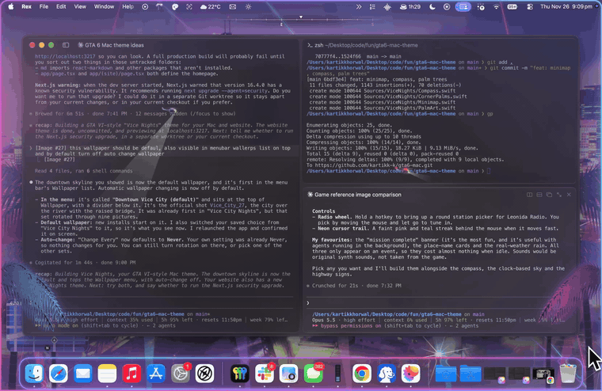

# Vice Nights

A menu bar app that themes your Mac after GTA VI's Vice City at night.



[Download Vice Nights 1.0](https://github.com/kartikk-k/gta6-mac/releases/latest) (signed and notarized, macOS 14+).

- **Wallpaper**: official night shots, nightlife shots and sunset key art from rockstargames.com/VI,
  downloaded on first use into `~/Library/Application Support/ViceNights/official` (nothing bundled),
  plus a generated "Neon Skyline" scene. Slow Ken Burns drift, crossfades, optional colour grade.
- **Party lights**: searchlight beams and lasers sweeping up from the bottom (behind apps, or over them).
- **Neon screen border**: a glowing pink → violet → cyan frame round the whole display (rounded at the top).
- **Dock**: neon outline that tracks the Dock's exact size, palms behind each end.
- **Sky**: mostly a small police-style helicopter with a searchlight; tiny far-off helicopters,
  distant jets, the odd lone gull, and now and then a helicopter landing on the Dock.
- **Leonida Radio**: "Run Away With Me", with links to play it on Apple Music, Spotify or YouTube.
- **Click the wallpaper** still reveals the desktop (the app re-implements macOS's gesture,
  which can't see through the theme's layers).

Your real wallpaper and Dock are never modified: everything is drawn in click-through windows,
so quitting (menu → Quit & Restore Desktop) puts everything back instantly, even after a crash.

## Build & run

```sh
./scripts/build-app.sh
open build/ViceNights.app
```

Grant Accessibility when asked (System Settings → Privacy & Security → Accessibility → Vice Nights)
so the neon outline tracks the Dock's exact size. Without it the size is estimated.
The build script signs with your Apple Development identity when present, so the permission survives rebuilds.
